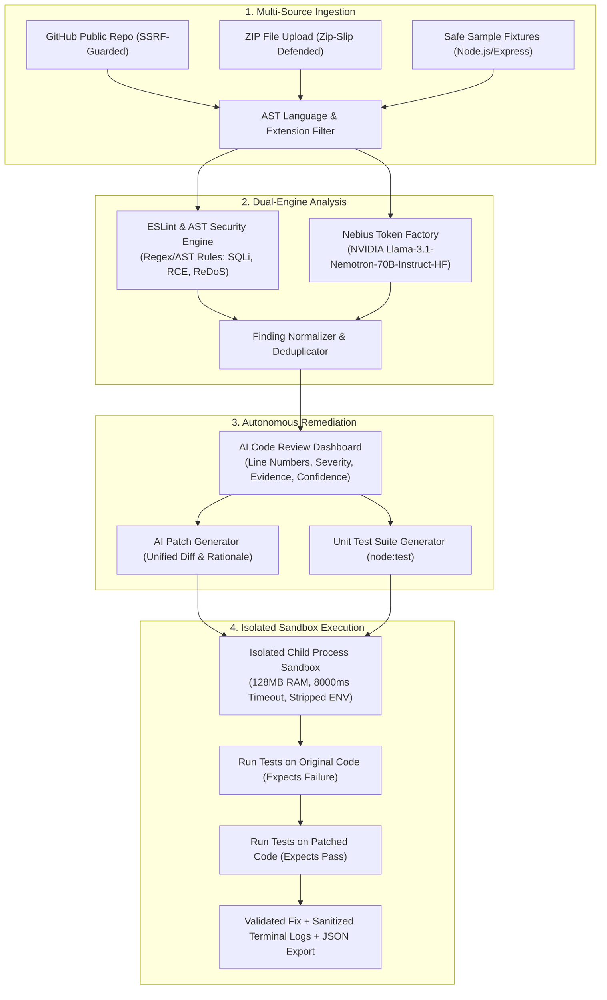

# 🛡️ CodeSentry AI — Autonomous Software Engineering Agent

> An autonomous software engineering and security audit agent powered by **NVIDIA Nemotron** open-source models hosted on **Nebius Token Factory**, with real-world AST static analysis, automated patch generation, and isolated sandbox validation.

---

## 1. Project Overview & Problem Statement

Software engineering teams spend thousands of hours manually reviewing pull requests, chasing regressions, and triaging security vulnerabilities (SQL injections, prototype pollution, path traversals, logic edge cases). Traditional static linters produce high false-positive rates with zero explanatory power, while generic conversational AI models frequently hallucinate fake line numbers, invent nonexistent APIs, or propose unverified code fixes that break production.

**CodeSentry AI** solves this through a **closed-loop agentic workflow**:
1. **Multi-Source Ingestion**: Ingests public GitHub repositories via REST API, project ZIP archives with Zip-Slip defense, or safe pre-packaged demonstration microservices.
2. **Dual-Engine Audit**: Blends deterministic ESLint and AST security heuristics with **NVIDIA Nemotron open-source LLM inference** on **Nebius Token Factory**.
3. **Actionable Structured Findings**: Pinpoints exact line numbers, severity ratings (Critical, High, Medium, Low), attack vectors, impact, and concrete remediation steps.
4. **Interactive Patch Generator**: Generates minimal, focused patches with side-by-side and unified diffs. *Never silently modifies original files without explicit developer review and approval.*
5. **Secure Isolated Sandbox Validation**: Automatically generates unit tests with Node.js built-in test runner (`node:test`, `node:assert`) and runs them in a sandboxed, resource-capped child process. It compares pre-fix failure against post-fix success, mathematically proving the fix resolves the issue without introducing regressions.

---

## 2. Architecture & Agent Workflow



---

## 3. Technology Stack

### Frontend
- **React 18** with **Vite** for ultra-fast builds and HMR.
- **Tailwind CSS** with custom dark theme, subtle borders, and NVIDIA-inspired emerald/cyan accents.
- **Lucide React** for professional developer iconography (zero emoji as interface controls).
- **React Router v6** for client-side routing.
- **Axios** for communication with backend endpoints.

### Backend
- **Node.js** (v24.x LTS / ESM modules).
- **Express.js** with Helmet, CORS, and Express-Rate-Limit.
- **Nebius Token Factory API**: OpenAI-compatible client targeted at `https://api.tokenfactory.nebius.com/v1/`.
- **NVIDIA Model**: `nvidia/Llama-3.1-Nemotron-70B-Instruct-HF` (or configurable Nemotron variants).
- **Static Analysis**: ESLint programmatic linter (`@eslint/js`, `eslint`) and AST rule engines.
- **Secure Sandbox**: Node.js child process isolation with stripped environment variables, hard timeouts, and memory constraints.
- **Persistence**: MongoDB adapter when `MONGODB_URI` is supplied; local JSON store (`server/data/db.json`) for zero-dependency local execution.
- **Zod**: Robust runtime environment and payload validation.

---

## 4. How NVIDIA Nemotron & Nebius Token Factory are Used

### The Model: NVIDIA Llama-3.1-Nemotron-70B-Instruct-HF
Nemotron is NVIDIA's open-source, high-capability model family tuned specifically for reasoning, coding assistance, and structured output formatting. In CodeSentry AI:
- **Code Review**: Analyzes code snippets with strict JSON schemas, generating verifiable line references, confidence scores (0.0 to 1.0), and CWE security classifications.
- **Fix Generation**: Formats minimal patches in standard unified diff format (`--- a/...`, `+++ b/...`) with clear engineering explanations.
- **Test Generation**: Crafts self-contained `node:test` suites that assert the specific vulnerability or logic bug is eliminated.

### Inference Infrastructure: Nebius Token Factory
Nebius provides hyperscale AI cloud infrastructure powered by native NVIDIA GPUs:
- **Base URL**: `https://api.tokenfactory.nebius.com/v1/`
- **Authentication**: `Authorization: Bearer <NEBIUS_API_KEY>`
- **Structured JSON Mode**: Prompt engineering and fallback sanitization ensure reliable JSON parsing even when markdown backticks are returned.
- **Graceful Fallback**: If `NEBIUS_API_KEY` is not yet configured, the system automatically runs in **Static & Demo Mode**, maintaining full UI responsiveness, AST rule detection, diff generation, and sandbox test execution without fabricating fake AI results.

---

## 5. Repository Structure

```
codesentry-ai/
├── client/                     # Vite + React Frontend
│   ├── src/
│   │   ├── components/         # SeverityBadge, CodeViewer, DiffViewer, ValidationModal, Skeletons
│   │   ├── layouts/            # DashboardLayout (Sidebar, live metrics, status pill)
│   │   ├── pages/              # LandingPage, DashboardPage, AnalyzerPage, AnalysisResultsPage, HistoryPage, SettingsPage
│   │   ├── services/           # Axios API client
│   │   ├── App.jsx             # React Router routing
│   │   ├── main.jsx            # Entry point
│   │   └── index.css           # Tailwind directives & dark theme
│   ├── vite.config.js          # Vite config with API proxy
│   └── tailwind.config.js      # Custom theme colors (NVIDIA green, Nebius blue)
├── server/                     # Express.js Backend
│   ├── src/
│   │   ├── config/             # Zod environment variable parsing
│   │   ├── controllers/        # repoController, analysisController, findingsController, configController
│   │   ├── fixtures/           # Safe demo sample repository (vulnerable ecommerce service)
│   │   ├── middleware/         # Error handler, rate limiters
│   │   ├── routes/             # API routing definition
│   │   ├── services/           # nebiusAiService, staticAnalyzer, sandboxRunner, repoIngestionService, agentPipeline
│   │   ├── storage/            # Universal DataStore (MongoDB + local JSON db.json)
│   │   ├── app.js              # Express app setup
│   │   └── server.js           # Server bootstrap
│   └── test/                   # Automated backend unit tests (15 passing tests)
│       ├── staticAnalyzer.test.js
│       ├── sandboxRunner.test.js
│       ├── repoIngestion.test.js
│       └── nebiusAi.test.js
├── LICENSE                     # MIT License
├── package.json                # Root package with concurrently scripts
└── README.md                   # Hackathon documentation
```

---

## 6. Installation & Quick Start

### Prerequisites
- **Node.js** v18.x or higher (Node.js v24.x recommended).
- **npm** v9.x or higher.
- (Optional) A **Nebius Token Factory API Key** for active NVIDIA Nemotron inference.

### 1. Clone & Install Dependencies
From the repository root:
```bash
# Install root, backend, and frontend packages
npm install
npm --prefix server install
npm --prefix client install
```

### 2. Configure Environment Variables
Copy `.env.example` in `server/`:
```bash
cp server/.env.example server/.env
```
Edit `server/.env`:
```env
PORT=5001
NEBIUS_API_KEY=your_nebius_token_factory_key_here
NEBIUS_BASE_URL=https://api.tokenfactory.nebius.com/v1/
NEBIUS_MODEL=nvidia/Llama-3.1-Nemotron-70B-Instruct-HF

# Optional: GitHub personal access token for higher rate limits
GITHUB_TOKEN=

# Optional: MongoDB connection string (leave blank for zero-config local JSON persistence)
MONGODB_URI=
```

### 3. Start Development Mode
Run both backend and frontend concurrently with one command:
```bash
npm run dev
```
- **Backend API**: `http://localhost:5001`
- **Frontend Cockpit**: `http://localhost:5173`

Or run them in separate terminals:
```bash
# Terminal 1: Backend
npm --prefix server run dev

# Terminal 2: Frontend
npm --prefix client run dev
```

---

## 7. Running Backend Unit Tests

CodeSentry AI includes comprehensive unit tests verifying the static analyzer, isolated sandbox test runner, SSRF defense, and Nebius AI JSON parsing:

```bash
npm run test:server
```

**Test Output:**
```
▶ Nebius AI Service - NVIDIA Nemotron Integration
  ✔ reports status and provider without leaking credentials
  ✔ handles missing credentials cleanly without throwing uncaught errors
  ✔ safely parses JSON from model responses containing markdown backticks
✔ Nebius AI Service - NVIDIA Nemotron Integration

▶ Repository Ingestion & Security Validation
  ✔ parses valid GitHub repository URL
  ✔ rejects SSRF attempts targeting localhost or private IPs
  ✔ loads safe sample demonstration repository
✔ Repository Ingestion & Security Validation

▶ Sandbox Runner - Secure Test Execution
  ✔ executes unit tests and detects passing code
  ✔ enforces execution timeout on infinite loops
✔ Sandbox Runner - Secure Test Execution

▶ Static Analyzer - Security Rule Engine
  ✔ detects SQL injection via string concatenation
  ✔ detects prototype pollution vulnerability
  ✔ detects dangerous eval execution via ESLint
✔ Static Analyzer - Security Rule Engine

ℹ tests 15 | pass 15 | fail 0
```

---

## 8. Backend API Documentation

| Method | Endpoint | Description |
|---|---|---|
| `GET` | `/api/health` | Healthcheck and server uptime |
| `GET` | `/api/config/status` | Nebius Token Factory status, active model, and limits (credentials redacted) |
| `POST` | `/api/config/test-nebius` | Tests live connectivity to Nebius Token Factory API |
| `GET` | `/api/stats/overview` | Aggregated dashboard metrics (scans, severity counts, validated fixes) |
| `POST` | `/api/repositories/inspect` | Validates GitHub URL and fetches repository file tree |
| `POST` | `/api/repositories/upload-zip` | Uploads and safely extracts a project `.zip` archive |
| `GET` | `/api/repositories/samples` | Lists pre-packaged vulnerable sample fixtures |
| `POST` | `/api/analysis/start` | Initiates the 4-stage agent audit pipeline |
| `GET` | `/api/analysis/:id` | Retrieves a specific scan record and its findings |
| `GET` | `/api/analysis/history` | Lists all historical audits with filtering |
| `GET` | `/api/analysis/:id/export` | Downloads full audit report as structured JSON |
| `POST` | `/api/findings/:id/generate-fix` | Generates an AI patch with unified diff and rationale |
| `POST` | `/api/findings/:id/generate-tests` | Generates executable Node.js unit tests for a finding |
| `POST` | `/api/findings/:id/validate` | Executes before/after tests in the isolated sandbox |

---

## 9. Security & Safety Considerations

- **No Remote Code Execution on Host**: Generated code is **never** executed inside the main Express server process. All tests run in isolated child processes with memory limits (128MB) and hard timeouts (8 seconds).
- **Environment Sanitization**: Child processes inherit stripped environment variables, preventing exposure of `NEBIUS_API_KEY`, `GITHUB_TOKEN`, or database credentials to tested code.
- **SSRF Defense**: The GitHub repository inspector permits only `github.com` URLs, rejecting attempts to probe `localhost`, `127.0.0.1`, or AWS metadata (`169.254.169.254`).
- **Zip-Slip Protection**: ZIP archives are validated to ensure entry filepaths cannot escape the target directory using path traversal sequences (`../`).
- **Human-in-the-Loop**: Generated patches are presented as proposals. Code is never modified or pushed without user approval.

---

## 10. Hackathon Demo Walkthrough

1. Open `http://localhost:5173`.
2. Click **"Explore Demo"** or **"Run Demo Scan"** on the landing page or dashboard.
3. CodeSentry AI automatically ingests the sample e-commerce microservice and executes the 4-stage pipeline:
   - Identifies **SQL injection** in `authService.js`.
   - Identifies **hardcoded JWT secret** in `authService.js`.
   - Identifies **discount calculation logic bug** allowing negative checkouts in `paymentService.js`.
   - Identifies **prototype pollution** in `objectMerger.js`.
   - Identifies **path traversal** in `reportController.js`.
4. Click **"Generate Fix"** on any finding to review the unified diff proposed by NVIDIA Nemotron.
5. Click **"Validate in Sandbox"** to run the generated unit tests in an isolated child process. Observe the live terminal logs showing the test failing against the original code and passing against the patched code!
6. Click **"Export Audit JSON"** to download the complete audit report.

---

## 11. Future Roadmap

- [ ] **Multi-Language Sandbox**: Expand sandboxed test runners to Python (`pytest`), Rust (`cargo test`), and Go.
- [ ] **Automated GitHub PR Creation**: One-click pull request generation for approved patches using GitHub Apps.
- [ ] **Continuous CI/CD Action**: GitHub Action workflow wrapper for automated PR security gates.
- [ ] **Fine-Tuned Nemotron Checkpoint**: Fine-tune Nemotron on curated vulnerability-patch datasets using Nebius AI Studio.

---

## License

This project is open-source under the [MIT License](LICENSE).
